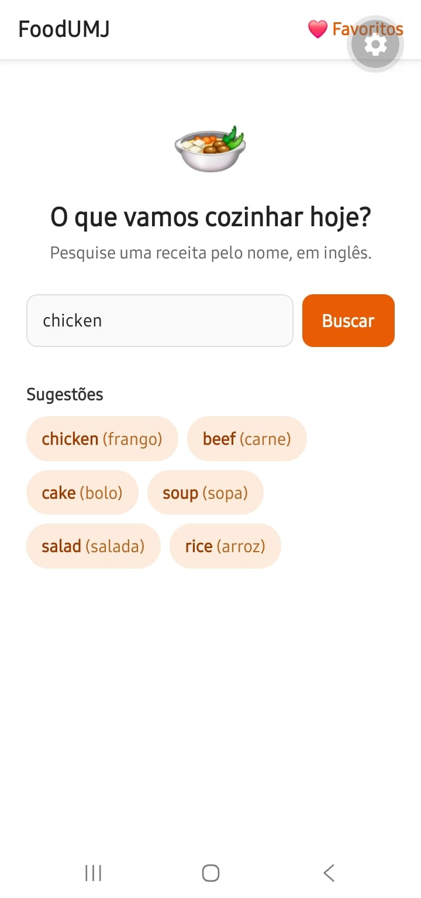
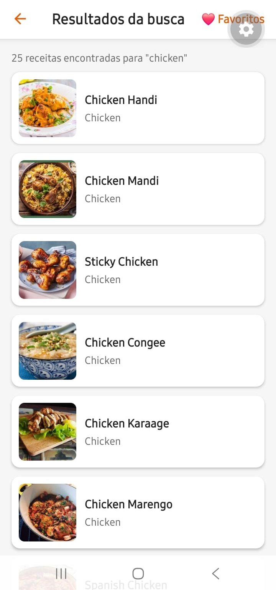
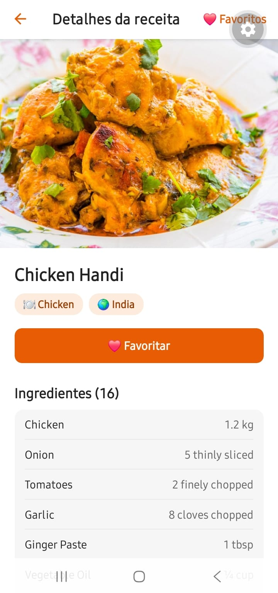
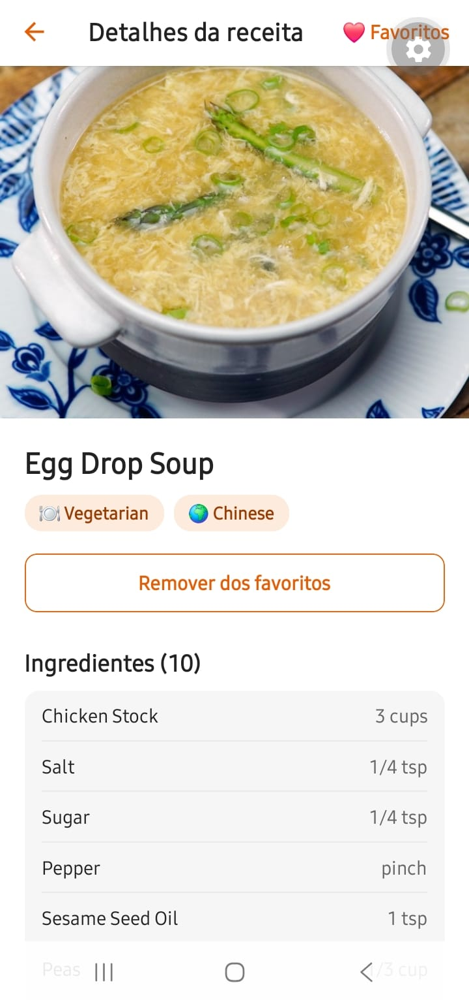
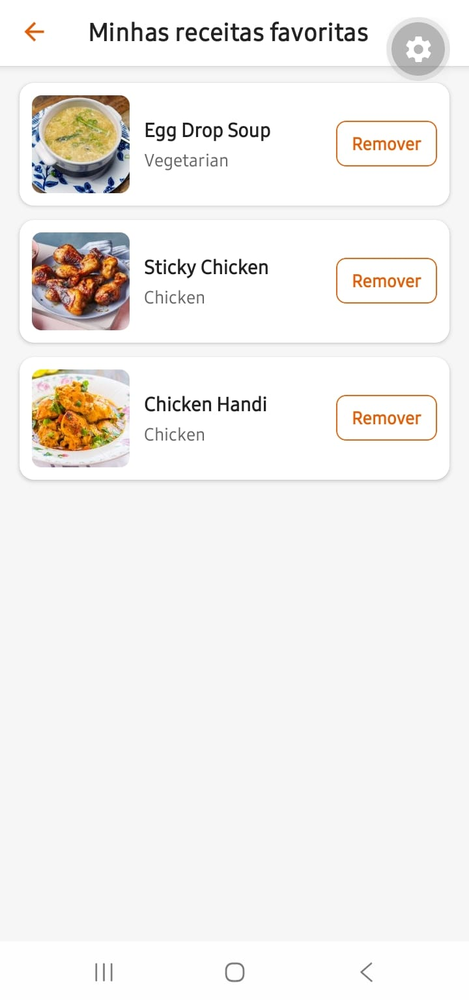

# FoodUMJ: Receitas

Aplicativo mobile feito em **React Native + Expo** para **pesquisar receitas**, ver os **detalhes** de cada uma (nome, imagem, ingredientes e modo de preparo) e **salvar as favoritas**.

Trabalho de Programação Mobile, feito em dupla.

## Integrantes

| Nome | GitHub | Parte |
|---|---|---|
| Marcelo | [@mlucasoliv](https://github.com/mlucasoliv) | Base do app: projeto, API, componentes, navegação, contexto e telas de início, resultados e detalhes |
| Pedro Tavares | [@lPedroTl](https://github.com/lPedroTl) | Favoritos, acabamento visual, testes finais e entrega |

## Funcionalidades

- Pesquisa de receitas por nome
- Lista de resultados com foto, nome e categoria
- Tela de detalhes com foto, categoria, origem, ingredientes e modo de preparo
- Favoritar e remover receitas (lista global compartilhada entre as telas)
- Tela de favoritos
- Indicador de carregamento, mensagens de erro com "Tentar novamente" e aviso de lista vazia

## Telas

| Tela | O que faz |
|---|---|
| **Início** | Campo de pesquisa e sugestões de termos |
| **Resultados** | Lista de receitas encontradas para o termo buscado |
| **Detalhes** | Informações completas da receita e botão de favoritar |
| **Favoritos** | Receitas salvas, com opção de remover |

> Os prints das telas estão na seção [Prints](#prints).

## Tecnologias

- [React Native](https://reactnative.dev/) com [Expo](https://expo.dev/) (template `blank`)
- JavaScript
- [React Navigation](https://reactnavigation.org/) (Native Stack)
- `useState` para o estado das telas e `useContext` para os favoritos
- `fetch` para as requisições

## API utilizada

[TheMealDB](https://www.themealdb.com/api.php): API gratuita, sem necessidade de chave.

| O quê | Endpoint |
|---|---|
| Buscar por nome | `https://www.themealdb.com/api/json/v1/1/search.php?s=chicken` |
| Detalhes por id | `https://www.themealdb.com/api/json/v1/1/lookup.php?i=52795` |

**Importante:** a API está em inglês. As buscas funcionam com termos como `chicken`, `beef`, `cake` e `soup`. A interface do app está em português.

## Como rodar

### Pré-requisitos

- [Node.js](https://nodejs.org/) (versão LTS)
- [Git](https://git-scm.com/)
- App **Expo Go** instalado no celular (Android ou iOS)
- Celular e computador na **mesma rede Wi-Fi**

### Passo a passo

```bash
git clone https://github.com/mlucasoliv/programa-o-mobile-trabalho.git
cd programa-o-mobile-trabalho/FoodUMJ
npm install
npx expo start
```

Escaneie o QR code com o Expo Go (no Android, pelo próprio app; no iPhone, pela câmera).

### Problemas comuns

- **QR code não conecta:** confira se os dois aparelhos estão na mesma rede. Se a rede bloquear, use `npx expo start --tunnel`.
- **Erro "execução de scripts desabilitada" no PowerShell (Windows):** use o Prompt de Comando ou o Git Bash.
- **Erro de versões após `npm install`:** rode `npx expo install --check`.

## Estrutura do projeto

```
programa-o-mobile-trabalho/
├── ROTEIRO.md
├── README.md
└── FoodUMJ/
    ├── App.js                      navegação e Provider dos favoritos
    └── src/
        ├── services/api.js         chamadas à TheMealDB
        ├── components/             Carregando, MensagemErro, ReceitaCard
        ├── screens/                Home, Resultados, Detalhes, Favoritos
        ├── context/                FavoritosContext
        └── utils/ingredientes.js   junta ingredientes e medidas
```

## Prints

| Início | Resultados | Detalhes |
|---|---|---|
|  |  |  |

| Receita favoritada | Favoritos |
|---|---|
|  |  |

## Créditos

- Dados e imagens das receitas: [TheMealDB](https://www.themealdb.com/)
